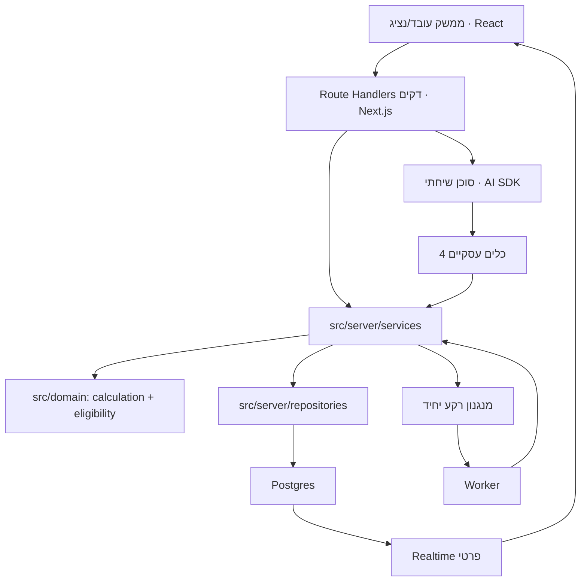

<!-- dir: rtl -->
# Design Document

**מסמך עיצוב — יועץ הרכב של שטראוס**

> מסמך זה הוא שכבת ההחלטות וההנדסה שמעל שני מקורות הקלט: `requirements.md` (מזוהה בדרישות `REQ-*` ובקריטריוני קבלה `AC-*`) ומסמך הארכיטקטורה הראשי (`Strauss_Architecture_and_Plan_v1`, מזוהה בסעיפים §1–§19). המסמך **מפנה** למקורות ואינו משכפל אותם: היכן שהדרישה כבר מוגדרת, מצוין המזהה בלבד, וכאן נקבעות ההחלטות, החוזים והנימוקים שעוד לא הוכרעו שם. עקרון מנחה: תשתית פשוטה ככל האפשר תוך שמירה על **מלוא** יכולות המוצר (§1, היקף היעד).

---

## Overview

סקירה — ראו §1 (סקירה וארכיטקטורה) להלן.

## Architecture

ארכיטקטורה — ראו §1 ו-§2 להלן.

---

## 1. סקירה וארכיטקטורה

### 1.1 בחירת הארכיטקטורה

מונולית מודולרי ב-TypeScript על Next.js App Router עם React, סוכן שיחתי מעל AI SDK, ו-Supabase כשכבת הנתונים והתשתית (Postgres / Auth / Storage / Realtime). ההחלטות עצמן מנומקות ב-§2 של מסמך הארכיטקטורה; כאן נקבע **כיצד** הן מתממשות כגבולות קוד.

הנימוק לפשטות: כל יכולות היעד (§1 "היקף היעד להגשה") ניתנות למימוש בתהליך שרת יחיד עם מודולים מופרדים, בלי שירותי רשת נפרדים לכל יכולת. הוספת רכיב (LangGraph, מסד וקטורי, Kubernetes, multi-agent) נדחית עד שניסוי יוכיח בעיה שהארכיטקטורה הזו אינה פותרת (§2).

### 1.2 גבולות מודולים

מבנה הפרויקט לפי טבלת §3 ("מבנה פרויקט מוצע") במסמך הארכיטקטורה. ההחלטות המחייבות שמעבר למבנה:

- **קריאות בין שירותים הן קריאות קוד in-process**, לא HTTP פנימי. הסוכן, ה-Route Handlers וה-Worker קוראים לאותם `src/server/services` ו-`src/server/repositories`.
- **אין לוגיקה עסקית כפולה**: זכאות, חישוב, השתתפות ומיון קיימים פעם אחת ב-`src/domain` ו-`src/server/services`, ונצרכים משלושה כיווני קריאה (UI, סוכן, worker). אוכף את AC-4.3.1, AC-6.4.1 והוראת ביצוע §16.5.
- **חבילת החישוב `src/domain/calculation` טהורה ומבודדת**: אין בה import ל-Next, מודל, מסד או שירות רשת (REQ-2.2 / AC-2.2.1, §10). גבול היבוא נאכף בכלי lint-boundaries בשלב ההקמה.
- **ה-Worker משתמש באותם מודולים ואותו repository** כמו השרת (§3). אין בסיס קוד שני לעבודות רקע.
- **אין חישוב במסכי React, ב-prompt או ב-Route Handler** (§16.4). Route Handlers דקים בלבד: אימות, ולידציה, הפניה לשירות.

התרשים מתאר אחריות, לא מספר שרתים (זהה לכוונת §3). פירוט חוזי הכלים — ראו §4 כאן.

---

## 2. גרסאות ותוכנית נעילה

גרסאות מדויקות ו-lockfile **נדחים לשער שלב 0/1** (§16, "שלב 0 — ייצוב חוזים"; הוראת ביצוע: לבדוק תאימות בתיעוד הרשמי ולנעול גרסאות מדויקות). אין לנעול גרסת patch מהזיכרון — נעילה מתבצעת מול התיעוד הרשמי בזמן ההקמה, עם lockfile ותיעוד גרסת runtime.

**בסיס שמרני ויציב מוצע (baseline, לאימות בשער):**

| רכיב | בסיס מוצע | הערה לשער הנעילה |
|---|---|---|
| מסגרת | Next.js 15 + React 19 | Next 16 קיים ויוערך בשער, לא מונח כברירת מחדל |
| שכבת AI | AI SDK 5 | AI SDK 6/7 קיימים ויוערכו בשער; אין לערבב דוגמאות מגרסאות מרכזיות שונות (§2) |
| מסד/תשתית | `@supabase/supabase-js` v2 | — |
| חישוב | `decimal.js` | מחייב ל-AC-0.1.4 / AC-2.2.1 |
| ולידציה | Zod | בקצה; בנוסף לאילוצי Postgres (§2) |
| בדיקות | Vitest + Playwright | חישוב/שירות ביחידה, מסכים/שיחה ב-E2E |
| PBT | ספריית property לפי שפת היעד (למשל `fast-check` ל-TS) | ראו §12 (אסטרטגיית בדיקות) |

**מזהה דגם המודל נותר פתוח (O8).** נבחר ב-shortlist וב-eval על אותו סט שיחות (REQ-1.3, REQ-7.2), ואינו מקודד קשיח. דגם השיחה ודגם החילוץ עשויים להיות זהים או שונים — הכרעה לפי עברית, כלים, זמן ועלות בפועל (§5).

### 2.1 זיהוי גרסת rule-set לפי תוכן (לא לפי version)

קיימים כעת **שני** קבצי rule-set עם **אותה** מחרוזת `version` (`mock-2026-10-12`): הקובץ הישן והקובץ המעודכן (שמוסיף `contributionsBase`, `pensionCredit.maxContributionRate`, `participation`, `rounding`, ו-`familyTrack.priceSource` + `familyTrack.cars` במקום `carPrice`). לכן **אין להסתמך על מחרוזת ה-version כמזהה גרסה**: המערכת **חייבת** להבחין בין גרסאות rule-set לפי **hash תוכן** (source hash הנשמר ב-`rule_sets`), ולא לפי ה-version לבדו. הקובץ הישן נשאר זמין עבור תיקים קיימים, ומעבר לקובץ המעודכן הוא **גרסת dataset/rule_set חדשה מפורשת** המחייבת recompute מפורש — ייבוא קובץ חדש **אינו מחליף בשקט** את ה-dataset של תיק קיים (§9 במסמך הארכיטקטורה). הדבר מחזק את ניהול הגרסאות שב-REQ-2.1 ו-REQ-1.2.

---

## Data Models

מודלי נתונים — ראו §3 (מודל נתונים) להלן.

## 3. מודל נתונים

הסכמה המלאה מוגדרת ב-§7 של מסמך הארכיטקטורה (כל הטבלאות המנויות שם). כאן נקבעות החלטות הקונסולידציה, האילוצים המחייבים והאינדקסים, ללא שכפול תיאור השדות.

### 3.1 קונסולידציות שהוחלטו

מותר לאחד טבלאות כל עוד לא נפגעים מקור/היסטוריה/הרשאות/עקביות. הקונסולידציות:

1. **`turn_runs` + `messages`**: נשמרות **נפרדות**. אין לאחד — `messages` הוא תוכן UI אידמפוטנטי לפי `(case_id, client_message_id)`, בעוד `turn_runs` הוא מצב ריצה (lease, retry, abandoned) בעל מחזור חיים שונה. איחוד היה פוגע בשחזור (REQ-3.4, REQ-8.3).
2. **`comparison_requests` + `comparisons`**: נשמרות **נפרדות**. בקשה היא כוונה הניתנת לביטול/שינוי (`request_revision`), תוצאה היא immutable (AC-5.5 / §8 "comparison שהושלם אינו נכתב מחדש"). איחוד היה פוגע באי-השינוי.
3. **`field_proposals` + `extractions`**: `extractions` מתעד ריצת חילוץ ממסמך (provenance, page/evidence); `field_proposals` הוא תור ההצעות לאישור, שמקורו עשוי להיות גם חילוץ וגם הקלדה. נשמרות נפרדות כדי לא לקשור כל הצעה למסמך (REQ-7.2).
4. **`jobs`**: טבלת מצב יישומי יחידה. אם ייבחר pgmq, מנגנון ההובלה שלו הוא **הסמכות למסירה**, ו-`jobs` משמש לראיית תפעול/גרסה בלבד — אין שני מנגנוני lease מתחרים (§7, §12; ראו §7 כאן).
5. **`fact_metadata` + `case_facts`**: נפרדות. `case_facts` הוא הערכים; `fact_metadata` הוא scope/מקור/סטטוס/תחולה לכל שדה. ההפרדה נדרשת כדי לייצג `unknown/not_applicable/known` בלי `null` רב-משמעי (AC-4.1.3).

כל שאר הטבלאות ב-§7 נשמרות כפי שהן.

### 3.2 אילוצים מחייבים (נאכפים במסד, לא רק ב-UI)

| אילוץ | מימוש | מקור |
|---|---|---|
| בדיוק baseline אחד לכל תיק פעיל | partial unique index על `scenarios(case_id) WHERE role='baseline'`; יצירה אטומית; איסור מחיקת baseline עצמאי (רק החלפה אטומית) | AC-3.1.2, AC-3.1.3, §7 |
| קישור חלופה לאותו תיק ול-dataset תואם | מפתח זר מורכב `(case_id, scenario_id)` + אילוץ התאמת `dataset_id` של הרכב | AC-3.1.4, §7 |
| ייחודיות שווי שימוש בתוך גרסת מקור | unique על `(source_id, tax_year, registration_year, vehicle_type_code, manufacturer_code, model_code)` | AC-1.2.4, §7 |
| comparison שהושלם אינו משתנה | אין UPDATE על שורה עם `completed_at` לא ריק; תיקון מפיק שורה חדשה | §8, AC-5.5 |
| הפרדת השתתפות אישית / default קטלוגי / פער משפחתי | שלושה שדות/עמודות נפרדים, ללא ספירה כפולה | AC-2.2.8, AC-2.5.4, §7 (ראו §10 כאן ו-O6 ב-§10 יומן) |
| ייחודיות הודעה | unique `(case_id, client_message_id)`; `sequence` ייחודי בתיק | §7 |
| ייחודיות request_id בהקשר actor+operation | unique `(actor_id, operation, request_id)`; אותו key עם payload שונה = conflict | AC-3.3.3, AC-3.3.4, §7 |
| provenance לקוד סוג רכב | `vehicles.vehicle_type_code` + `vehicles.type_resolution_source` (לא ריק) | AC-2.1.3, REQ-2.1, O14 (§10 יומן) |

### 3.3 טיפוסים ואינדקסים

- **כספים**: `numeric` בדיוק מוגדר במדיניות (§7), לא floating point (AC-0.1.4). בגבולות בין רכיבים — מחרוזת עשרונית קנונית (AC-0.1.1, §4 כאן).
- **הפרדת שנים**: לוחות חישוב 2025 ב-`rule_sets`; מקור שווי שימוש 2026 ב-`tax_value_sources`/`vehicle_tax_values` — שני שדות שונים שאין לעדכן זה לזה (AC-2.8.1, AC-2.8.2, §9).
- **אינדקסים** (§7): `cases(owner_id, updated_at)`, `messages(case_id, sequence)`, `inquiries(scope, status, created_at)`, `jobs(state, next_attempt_at)`, `comparisons(case_id, completed_at)`, ומפתח המס הרשמי בן 5 החלקים.

### 3.4 קשרי ליבה

ראו תרשים ה-ER ב-§7 של מסמך הארכיטקטורה (אין צורך לשכפל). השינוי היחיד שהעיצוב מוסיף הוא שדה ה-provenance ב-`vehicles` (3.2 לעיל).

---

## Components and Interfaces

רכיבים וממשקים — ראו §4 (חוזי כלים ושירותים) ו-§5 (מנוע חישוב וזכאות) להלן.

## 4. חוזי כלים ושירותים

### 4.1 מעטפת אחידה

כל כלי וכל שירות עוטפים את התשובה במעטפת אחידה (§6 "מעטפת אחידה"). ההחלטות המחייבות:

- **זהות מוזרקת מהשרת בלבד**: `user_id`, `staff_role`, התיק המאומת, `message_id`, `request_id`. המודל אינו קובע `owner_id` או תפקיד, וכל מזהה שהמודל מספק נבדק שוב מול הקשר התיק (AC-3.2.1, AC-3.2.4).
- **סטטוסים סגורים (enum)**: `success | missing_data | clarification_required | ineligible | conflict | retryable_error`. סירוב הרשאה אינו חושף קיום תיק של אחר (AC-3.2.2).
- **פורמט קנוני**: סכומים כמחרוזת עשרונית (`"14200.00"`), תאריכים ISO, סוגי פעולה כ-enum (AC-0.1.1–0.1.3). אין להעביר `"14,200 ₪"`.
- **שדות עזר אחידים**: `requiredFields` כשחסר, `clarificationOptions` כשיש עמימות, `versions`, וסיבות עסקיות מובנות.

### 4.2 ארבעת הכלים

הכלים מוגדרים ב-§6.1–§6.4 ו-REQ-5.3..5.5 / REQ-6.2. ההחלטות המחייבות שמעבר להם:

| כלי | החלטות עיצוב מחייבות | מקור |
|---|---|---|
| `updateCase` | פעולות typed בלבד (`set_fact`/`clear_fact`/`set_preference`/`remove_preference`/`create_alternative`/`update_alternative`), scope + שדה מרשימה מותרת + מקור; **אין JSON path שרירותי**; `clear` ≠ אפס; יחידת עדכון תלויה (סכום+סוגו) נשמרת יחד או כלל לא | AC-5.3.1–5.3.4, §6.1 |
| `searchVehicles` | שליפת שווי שימוש **תמיד** לפי מפתח 5 חלקים מדויק (§5 כאן), גם כשחיפוש השם משתמש בכינויים; לא להמציא מושבים/טווח/בטיחות; "קורולה" עמומה → הבהרה | AC-5.4.1–5.4.4, §6.2 |
| `compareScenarios` | שני מצבים `explicit` ו-`discover`; baseline מחושב פעם אחת לתמונת קלט; תוצאות `discover` נשמרות כחלופות נגזרות עם fingerprint ייחודי; מחזיר `coverage`, `excludedCandidates`, `incompleteCandidates`; אין "3 מיטביות" אם אחרות לא ניתנות לחישוב; אין delta אם ל-baseline חסר נתון | AC-5.5.1–5.5.8, §6.3 |
| `openInquiry` | `inquiryType` מרשימה סגורה; השרת בונה נמען והקשר; פנייה זהה פעילה מוחזרת כקיימת; הקשר שהשתנה באמת מאפשר פנייה חדשה | AC-6.2.1–6.2.4, §6.4 |

### 4.3 כללים משותפים

- פעולות UI ונציג משתמשות **באותם שירותים**, בלי להעביר טקסט דרך המודל כשאין צורך (§6, AC-4.3.1).
- **אין כלי SQL לסוכן** (AC-8.4.2). רצף קבוע בתוך כלי מתבצע בקוד, לא בפיצול לקריאות מודל.
- הפעלת כלים חסומה ב-steps/tokens/זמן/תקציב; בהגעה למגבלה נשמר המצב ומוחזרת תשובה ברורה בלי לולאת retry (AC-8.4.4, §6).

---

## 5. מנוע החישוב והזכאות

### 5.1 API פנימי

ארבע הפונקציות מוגדרות ב-§10 ("API פנימי"). ההחלטות המחייבות:

- `validateEligibility(employee, scenario, dataset) → eligible | ineligible | missing + reasons` (REQ-2.4 / AC-2.4.4).
- `resolveScenarioInput(facts, scenario, dataset) → CompleteInput | שגיאות/חסרים` — **אין `undefined` כאפס** (AC-2.2.11).
- `calculateScenario(CompleteInput, Rules) → ScenarioResult` — **פונקציה טהורה**: אותו קלט מלא + אותן גרסאות → אותו פלט עד האגורה; אין `Date.now`/אקראיות/מודל/רשת (AC-2.2.1).
- `compareResults(baseline, alternatives) → deltas + breakdown + coverage` (AC-5.5.2–5.5.3).

### 5.2 סדר חישוב (מחייב)

הסדר לפי §10 ("מודל נטו של האתגר") ו-REQ-2.2. הנקודות שהעיצוב מקבע:

1. שכר מזומן: בסיס + עמלות + בונוס + אחזקה מותרת + גילום חשמל כשחל.
2. בסיסי פנסיה וקה"ש — **פרמטרים מפורשים של rule-set, לא קבועים בקוד** (ראו O2/O3 ב-§10 יומן); אין להוסיף שווי שימוש או אחזקה לבסיס הפנסיוני כברירת מחדל (AC-2.6.2).
3. **שווי שימוש נכנס לבסיס המס + הביטוח הלאומי + הבריאות**, ואינו מזומן המשולם לעובד (AC-2.2.5).
4. מס פרוגרסיבי שולי לפי מדרגות ה-JSON פחות זיכויים; **זיכוי שאינו בר-החזר לא ייצר מס שלילי** (AC-2.2.2–2.2.4). נקודת זיכוי ×242 (AC-2.2.3).
5. ביטוח לאומי: סף 7,522 (1.04%) ותקרה 50,695 (7%); בריאות: אותו סף/תקרה (3.23% / 5.17%); ללא חיוב מעל התקרה (AC-2.2.6, AC-2.2.7).
6. ניכוי הפרשות עובד, השתתפות אישית ותוספת פער משפחתי — **ערכים נפרדים ללא ספירה כפולה** (AC-2.2.8, AC-2.5.4; עדות O6 ב-§10 יומן).
7. פלט נטו + פירוט רכיבים/בסיסים/הנחות + `incomplete` (AC-2.2.10, AC-2.2.11).

### 5.3 גילום חשמל

חישוב תוספת ברוטו `x` כך שהפרש הנטו הנובע ממנה הוא **בדיוק 250 ₪**, באמצעות **פתרון מספרי חסום** (bisection/חיפוש חסום) עם `Decimal`, גבול איטרציות ובדיקת תוצאה — **לא** נוסחת `250/(1-taxRate)` ו**לא** הוספת 250 נוספים לאחר הגילום (AC-2.3.1–2.3.3, §10 "גילום חשמל"). הפתרון חייב לכבד מעברי מדרגה, ספים ותקרות. מדיניות עיגול ברמת האגורה — O7 (נשארת מתועדת, §10 יומן).

### 5.4 זכאות ומסלולים

- קבוצה: בחירה מקבוצת הזכאות או נמוכה; גבוהה → `ineligible` עם סיבה (AC-2.4.1, AC-2.4.2). תקציבי א/ב/ג/ד לפי §10.
- ויתור: רק לפי טבלת עיסוקים; אחזקה חייבת במס ואינה פנסיונית; בוויתור מוסר שווי השימוש ומתווספת אחזקה (REQ-2.6).
- משפחתי: 4+ ילדים בקריטריון הגיל; **חלק העובד בפער = `max(0, עלות_הרכב - תקציב_הקבוצה) × 50%`** בניכוי מהנטו, בעלות הספציפית לרכב (CARNIVAL 6,000 / SANTA FE 5,600), לא ערך גלובלי (AC-2.5.2, AC-2.5.3). ההשתתפות הרגילה נגבית **בנוסף** ובנפרד (O6, §10 יומן).

---

## 6. גרסאות, טרנזקציות ומקביליות

התבנית המחייבת לכל חישוב ופרסום תוצאה:

1. **קריאת snapshot עקבי של הקלט** — שאילתה עקבית אחת, או טרנזקציית Repeatable Read מפורשת. **לא** "טרנזקציה" העוטפת כמה שאילתות `SELECT` ב-Read Committed.
2. **סגירת טרנזקציית הקריאה** לפני החישוב.
3. **הרצת המנוע הטהור מחוץ לכל טרנזקציה ארוכה** — החישוב אינו מחזיק נעילות.
4. **פרסום בטרנזקציית כתיבה קצרה** הבודקת מחדש את הגרסאות ואת סטטוס הבקשה ב-compare-and-set, ומעדכנת את `latest_result` רק אם המצב עדיין תואם (§8 של מסמך הארכיטקטורה).

ההחלטות המחייבות שמעבר לכך:

- `facts_revision` עולה **רק** כאשר נתון משותף המשפיע על חישוב משתנה, לא בעקבות העדפה שיחתית (AC-3.3.1).
- בקשת כתיבה עם `expected revision` שאינו תואם למצב הנוכחי מחזירה `conflict` עם המצב העדכני — **אין last-write-wins** (AC-3.3.2).
- תיקון ערך לאותו ערך קיים ללא שינוי סמנטי **אינו** יוצר גרסת חישוב חדשה (AC-3.3.5).

**חישוב קצר מיד לאחר תשובת נציג** רשאי לרוץ באותה בקשת שרת, **מחוץ** לטרנזקציה ארוכה, עם התאוששות מקריסה ובדיקת גרסה לפני פרסום (§12 במסמך הארכיטקטורה; REQ-6.3). צמד "שמירת תשובה + הוספת עבודת המשך" הוא אטומי (פונקציה צרה אחת), אך החישוב/הפרסום מתבצעים אחריו, מוגנים ב-compare-and-set.

**מקביליות שיחה:** לכל היותר ריצה אחת פעילה משנה-מצב לכל תיק (AC-3.4.1); הודעות נוספות נכנסות לתור לפי סדר או מסומנות במפורש כמחליפות; ריצות שנקטעו מסומנות `abandoned`/`retryable` לפי lease וזמן, ולעולם לא נותרות במצב "מקליד" לנצח (AC-3.4.2). כל mutation אידמפוטנטי, כך שקריסה בין החלת הנתונים לבין תשובת הטקסט אינה גורמת להחלה כפולה (AC-3.4.3).

---

## 7. התאוששות, עבודות רקע והתראות

### 7.1 מנגנון רקע יחיד

**מנגנון רקע משותף אחד** — אין לבנות תורים מתחרים (§7/§12 במסמך הארכיטקטורה). אם ייבחר pgmq, **מנגנון ההובלה שלו הוא הסמכות למסירה**, וטבלת `jobs` משמשת לראיית תפעול/גרסה בלבד — אין מנגנון lease שני.

סוגי עבודות: `extract_document`, `resume_comparison`, `send_notification`, `purge_expired_data` (AC-6.4.1). אין להפעיל מודל עבור מייל תבניתי או עבור חישוב דטרמיניסטי.

### 7.2 Worker, lease ואידמפוטנטיות

- **lease חסום בזמן עם הארכה**; fencing/בדיקת גרסה מונעים מ-Worker ישן לפרסם תוצאה לאחר שהעבודה נלקחה מחדש (AC-6.4.2).
- retry עם backoff ו-jitter, הבחנה בין כשל זמני לקבוע, מספר ניסיונות חסום, וסטטוס `failed` הנראה לתפעול (AC-1.4.2, AC-1.4.3).
- תופעות לוואי משתמשות במפתחות אידמפוטנטיות; קריסה לאחר שליחת מייל ולפני ack אינה שולחת פעמיים (AC-6.4.3, AC-6.4.4).
- שינוי קלט בזמן חישוב אינו מפרסם תוצאה "עדכנית" שגויה (AC-6.4.5).
- צמד "שמירת תשובה + הוספת עבודת המשך" בטרנזקציה **אחת** דרך פונקציה צרה; המייל/המודל **אינם** בתוך אותה טרנזקציה (REQ-6.3, AC-6.3.1).

### 7.3 התראות ו-Realtime

- התראות: "ההשוואה מוכנה" רק אם פורסמה תוצאה עדכנית; אחרת "התקבלה תשובה לפנייה". קישור לתיק בלבד, ללא שכר/מסמך; הקישור כשלעצמו אינו מעניק הרשאה — נדרש session תקף או התחברות (AC-6.5.1–6.5.4).
- Realtime הוא **אות רענון בלבד** — אין שכר/נתונים כספיים בהודעה; ערוץ פרטי לכל תיק; רענון ב-focus/reconnect; polling חסום בזמן כגיבוי כאשר הערוץ החי נכשל ויש עבודה ממתינה (AC-6.6.1–6.6.4, AC-8.3.x).

### 7.4 התאוששות

הודעת המשתמש נשמרת לפני ביצוע, וכל ריצה מקבלת מזהה; חזרה למסך טוענת מצב ותוצאה תקפים מהמסד; אם הפלט השיחתי חסר, מופק הסבר מהמצב השמור בלי לשחזר side effects; אין להסתמך על `onFinish` בלבד או על fire-and-forget (AC-8.3.1–8.3.4).

**הערה:** שחזור הזרמת stream בזמן אמת, token-אחר-token, **אינו** תנאי לאי-אובדן עבודה; אם ייאומץ, הוא מחייב תשתית resumable-stream מפורשת (§14 במסמך הארכיטקטורה).

---

## 8. אבטחה והרשאות

### 8.1 מטריצת גישה

לפי §13 במסמך הארכיטקטורה (עובד / נציג / Worker):

- **עובד** רואה אך ורק את התיקים שלו.
- **נציג** אין לו גישה כללית לתיקים, אלא רק לפניות בתוך תחום ההרשאה שלו.
- **Worker** ניגש לנתונים רק עבור העבודה המזוהה והמורשית שלו.

### 8.2 אימות ואכיפה דו-שכבתית

- אימות session בצד שרת; לעולם לא לסמוך על `userId` מהלקוח או על `getSession` לבדו (AC-3.2.3).
- פעולות משתמש רצות תחת הקשר המשתמש עם RLS, **בנוסף** לבדיקות שכבת השירות.
- מפתח service-role/סוד עוקף RLS — יש להגבילו ל**מודול admin נפרד** לעבודות מערכת בלבד; אין להשתמש ב-service-role גורף כתחליף לתכנון הרשאות (§13).

### 8.3 תפקיד נציג ותוכן בלתי מהימן

- תפקיד הנציג (`staff_role`) מוקצה **אך ורק** דרך מנגנון admin מוגן, לעולם לא מטקסט בשיחה או משדה פרופיל הניתן לעריכת המשתמש (AC-6.1.4, AC-6.1.5). deny-by-default; הנציג רואה רק את השדות הדרושים לפנייה (AC-6.1.1–6.1.3).
- **O13 (פתוח):** אמצעי אימות נוסף לנציג נותר פתוח; יש לבחור שיטה נגישה, בלי להניח שלכל אחד יש סמארטפון.
- תוכן בלתי מהימן: הוראות בתוך תלוש, הודעה או תשובת נציג אינן יכולות לשנות הרשאות או כללי מערכת (AC-8.4.1). אין כלי SQL לסוכן; שאילתות פרמטריות, סכמות runtime (Zod), רשימות שדות מותרות וגבולות סכום/אחוז (AC-8.4.2). אין רינדור HTML גולמי מהמודל; CSP ומדיניות origin; חסימת משאבים חיצוניים בלתי מהימנים (AC-8.4.3).

### 8.4 הגבלות קצב, סודות ולוגים

הגבלות קצב ל-OTP/הודעות/העלאות/חילוץ; חסימת steps/tokens/תקציב בהפעלת כלים (AC-8.4.4). סודות בצד שרת בלבד, ללא `NEXT_PUBLIC`, לא בלוגים/repo, ונסרקים לפני הגשה; הלוגים מתעדים מזהי בקשות/סוג כלי/זמן/tokens/סטטוס אך **לא** prompt מלא/שכר/מסמכים/OTP/signed URLs (AC-0.2.x, AC-8.4.5).

---

## 9. חוויית משתמש

רכיבים ו-design tokens (REQ-4, REQ-8.1). **הסגנון הוויזואלי המפורט עדיין בהחלטה** — יש לבנות רכיבים ו-design tokens כך שניתן יהיה לשנות את ה-skin **בלי** לשנות לוגיקה (tokens לצבע/מרווח/טיפוגרפיה/radius; אין סגנונות קשיחים בלוגיקה). RTL בכל המסכים; ניווט מקלדת, focus ברור, תוויות שדה, הודעת שגיאה סמוכה לשדה; הצבע אינו האמצעי היחיד להבחנה בין רווח להפסד; כיבוד reduced-motion; הודעות מצב נגישות (מחפש/מחשב/ממתין לנציג/תקלה) בלי הקראת כל token (AC-8.1.1–8.1.5).

### 9.1 החלטות UX סגורות (בעלת המוצר)

- קישור ה-**דמו** נפתח **ישירות** למסך היועץ, **ללא** דרישת מייל מקדימה. הביקור מבודד ומאפשר נתונים בדיוניים; שימוש אישי והעלאת מסמך מחייבים התחברות.
- במרכז מסך הפתיחה: הכותרת **"הרכב הבא שלך. מה הוא ישנה בנטו?"** ותיבת צ'אט בולטת.
- שאלות לדוגמה מוצגות **בעדינות** מתחת לתיבה, **לא** כשלושה כפתורים גדולים.
- לאחר תחילת הבירור, כרטיסי הרכבים וההשוואה מופיעים **לצד** השיחה.
- כפתור משני **"אזור נציג"** בפינה **השמאלית העליונה**; בדמו הוא פותח רק את פניות אותו ביקור, בשימוש רגיל הוא מחייב הרשאת נציג.
- סימון קבוע קטן **"סביבת הדגמה"** מספיק; אין לחזור על המילה בכל כפתור.
- כרטיס ההשוואה מציג סכומים מפלט המנוע בלבד (לעולם לא מוקלדים לתבניות ה-UI), הסבר בן שתי שורות עם פירוט נפתח, ומצב **"חלופה ממתינה"** כשחסר נתון ל-baseline — ללא delta מומצא (AC-4.2.1–4.2.5, AC-4.3.1, AC-4.3.2).

---

## 10. יומן החלטות

ההחלטות הבאות מתועדות עם העדות המאומתת:

- **O6 — הוכרע לפי עדות.** גיליון "חישובים" ב-Excel עבור E-002 (דוד, NIRO→CARNIVAL) מציג **שני** פריטים נפרדים: "השתתפות 250→500 ₪" **וגם** "חלק העובד בפער המסלול המשפחתי 1,150 ₪". שחזור מספרי של הנטו בחלופה של E-002: בסיסי ביטוח לאומי + בריאות משתחזרים ל-**בדיוק 1,879** (תואם לייחוס), והסרת הפער המשפחתי מזיזה את הנטו ב-**בדיוק 1,150** — מה שמוכיח ש**גם** ההשתתפות הרגילה (500) **וגם** חלק העובד בפער המשפחתי (1,150) מנוכים מהנטו. **החלטה:** המסלול המשפחתי מנכה את שניהם בנפרד (REQ-2.5, AC-2.5.4, §5.4). השארית הקטנה (~33 ₪ מול נטו ייחוס 5,078) מיוחסת ל-O2/O3 ו**אינה** מוכרעת כאן.
- **O14 — שיטת הכרעה (מתועדת, לא לפי סכום).** עמימות ATTO 3 (קוד תוצר 01014, קוד דגם 00003, שנת רישום 2025) מוכרעת לפי שדות **שאינם סכום**: עבור קוד סוג רכב `1`, עמודה 6 ב-CSV (תאור דגם) `SC2E-SC2E01` ועמודה 8 (כינוי מסחרי) `ATTO 3` תואמות **בדיוק** ל"תאור דגם" בקטלוג (`SC2E-SC2E01`) ול"דגם (כינוי מסחרי)" (`ATTO 3`); קוד סוג רכב `2` הוא `STE2-STE2`/`TANG` ואינו תואם. **החלטה:** היבוא מכריע את `vehicle_type_code` לפי התאמת תאור הדגם + הכינוי המסחרי בקטלוג מול שדות תאור הדגם + הכינוי המסחרי ב-CSV, ורושם את השדות התואמים כ-provenance של ההכרעה; התאמת סכום **לעולם** אינה הבסיס הבלעדי; רכבים בלתי מוכרעים/עמומים נחסמים (REQ-2.1, AC-2.1.3/2.1.4/2.1.5, §3.2).
- **O2 — הוכרע לפי הקובץ המעודכן.** `contributionsBase: "gross"` — הפרשות העובד לפנסיה ולקה"ש מחושבות על מלוא הברוטו (בסיס + עמלות + בונוס); הקובץ מציין שזו פשטה (simplification). `calculateScenario` מקבל את `contributionsBase` כפרמטר של rule-set (ברירת מחדל `gross` לפי קובץ זה).
- **O3 — הוכרע לפי הקובץ המעודכן.** `pensionCredit.maxContributionRate: 0.07` עם `incomeCeiling: 9500` → זיכוי הפנסיה (35%) חל על הפרשת הפנסיה של העובד עד 7% מהכנסה מזכה של 9,500 (= עד 232.75 ₪ לחודש), ולכן הזיכוי זהה בכל הדוגמאות גם בהפקדה של 6%. `calculateScenario` מקבל את `rate`/`maxContributionRate`/`incomeCeiling` כ**פרמטרים מפורשים של rule-set**.
- **O7 — הוכרע לפי הקובץ המעודכן.** `rounding.during: "none"`, `rounding.display: "shekel"` → **אין עיגול לאורך כל החישוב** (כולל גילום החשמל); עיגול לשקל שלם **רק** לתצוגה. זו בדיוק הסיבה שהעובד רואה הפרש נטו של **+250 ₪ בדיוק** (§5.3).
- **השתתפות (מבהיר סמוך ל-O1).** `participation.treatment: "net_deduction"`, `reducesValueOfUse: false` → ההשתתפות היא ניכוי נטו טהור ו**אינה** מקטינה את שווי השימוש החייב במס.
- **מחיר רכב במסלול המשפחתי.** `familyTrack.priceSource: "catalogue"` ו-`familyTrack.cars: ["CAR-19","CAR-20"]` (במקום `carPrice` יחיד) → משתמשים בעלות הקטלוגית הספציפית לרכב (CARNIVAL 6,000, SANTA FE 5,600), ומאשש את REQ-2.5 / AC-2.5.3.
- **אימות (מתועד).** באמצעות הקובץ המעודכן, שחזור מלא של כל ששת העובדים (היום + חלופה) תואם לנטו, למס ולבסיסי הביטוח הלאומי + הבריאות הייחוסיים **בדיוק עד השקל בכל 12 הערכים**; השארית הקודמת (~33 ₪ ב-E-002) **נעלמת** עם החלת תקרת זיכוי הפנסיה ובסיס ההפרשות על הברוטו. הדבר מאשר ש-RT-4 צפוי לעבור עם ה-rule-set החדש לאחר המימוש.
- **O1 — נותר פתוח.** שאלת **מקור ההשתתפות** (מתי ברירת מחדל קטלוגית רשאית לעמוד במקום ערך אישי מאומת) נותרת פתוחה; הקובץ החדש מגדיר רק **כיצד** ההשתתפות מטופלת בחישוב, לא מתי ברירת מחדל סמכותית.
- **O8 — מזהה הדגם נותר פתוח;** נבחר ב-shortlist וב-eval (§2).
- **O13 — נותר פתוח** (אמצעי אימות נוסף לנציג, §8.3).

---

## Correctness Properties

**תכונות נכונוּת (Property-Based Testing)**

תכונות נכונוּת ברות-הרצה למנוע הטהור וליבוא, כל אחת מזוהה לפי האינווריאנט שלה ולפי אסטרטגיית הייצור (generation strategy), עם הפניה ל-REQ/AC ולבדיקות ה-RT ב-`requirements.md` (נספח ב'). התכונות:

### Property 1: דטרמיניזם
*For all* קלט מלא ו-rule-set נתונים, `calculateScenario(אותו קלט, אותו rule-set)` מחזיר פלט זהה עד רמת האגורה.
**Validates: Requirements AC-2.2.1**

### Property 2: אפס-הפרש וסימטריה
*For all* תרחיש, השוואת התרחיש מול עצמו נותנת `delta = 0`; החלפת baseline/alternative הופכת את סימן ההפרש תחת אותה מדיניות עיגול.
**Validates: Requirements AC-2.2.1, AC-2.7.3**

### Property 3: מונוטוניות מס שולי
*For all* זוג בסיסי מס, הגדלת בסיס המס לעולם אינה מקטינה את סך מס ההכנסה.
**Validates: Requirements AC-2.2.2**

### Property 4: אי-שליליות
*For all* קלט, מס ההכנסה אינו שלילי כאשר הזיכויים עולים על המס לפני זיכוי (AC-2.2.4), והנטו אינו שלילי בשקט אלא מסומן כחריג מובנה (AC-2.2.9).
**Validates: Requirements AC-2.2.4, AC-2.2.9**

### Property 5: גילום חשמל
*For all* תרחיש חשמלי, תוצאת הפותר החסום (bounded) נותנת הפרש נטו בטווח העיגול המוגדר סביב **+250 ₪ בדיוק**, גם במעברי מדרגה/תקרה, בלי להוסיף 250 נוספים.
**Validates: Requirements AC-2.3.1, AC-2.3.2, AC-2.3.3**

### Property 6: שווי שימוש בבסיס בלבד
*For all* תרחיש, שווי השימוש מגדיל את בסיס המס, הביטוח הלאומי והבריאות אך אינו משולם כמזומן לעובד (AC-2.2.5); דמי האחזקה חייבים במס ואינם נכללים בבסיס הפנסיוני (AC-2.6.2).
**Validates: Requirements AC-2.2.5, AC-2.6.2**

### Property 7: חד-ערכיות מפתח
*For all* רכב בקטלוג, המפתח בן 5 החלקים מצביע לכל היותר על רשומת שווי שימוש אחת בתוך גרסת מקור נתונה; התאמה עמומה נחסמת ואינה נבחרת בשקט.
**Validates: Requirements AC-2.1.2, AC-2.1.4**

### Property 8: הפרדת השתתפויות
*For all* תרחיש משפחתי, ההשתתפות הרגילה ותוספת הפער המשפחתי מנוכות כסכומים נפרדים, ללא ספירה כפולה.
**Validates: Requirements AC-2.5.4**

**הערה:** התכונות מאומתות באמצעות ספריית PBT (למשל `fast-check`) לצד סוויטת רגרסיית ששת העובדים; ערכי `expected` לעולם אינם משתנים כדי להסתיר באג (AC-2.7.3).

---

## Error Handling

**טיפול בשגיאות**

מודל שגיאות מובנה:

- **מעטפת אחידה עם סטטוסים סגורים:** `success | missing_data | clarification_required | ineligible | conflict | retryable_error` (§4).
- **נתון חסר** מחזיר `requiredFields`, לא אפסים (AC-2.2.11, AC-2.1.2).
- **קונפליקטים** מחזירים את המצב הנוכחי, ללא last-write-wins (AC-3.3.2, AC-3.3.4).
- **כשל זמני מול קבוע** עם retry חסום + backoff + jitter וסטטוס `failed` הנראה לתפעול (§7).
- **התאוששות מקריסה** ללא החלה כפולה / שליחה כפולה, באמצעות מפתחות אידמפוטנטיות (§6, §7).
- **סירוב הרשאה** אינו חושף את קיום התיק של משתמש אחר (AC-3.2.2).
- **העלאות מוגנות בסיסמה / פגומות / בלתי נתמכות** מחזירות הסבר, ולא קבלה שקטה כתקינות (AC-7.1.3).

---

## Testing Strategy

**אסטרטגיית בדיקות**

זהו §12 שהוזכר קודם. השכבות:

- **יחידה (unit):** המנוע הטהור והשירותים, ב-Vitest.
- **PBT:** תכונות הנכונוּת שלעיל, ב-`fast-check`.
- **רגרסיית ששת העובדים ובדיקות גבול:** RT-4, RT-5, RT-6.
- **תאימות CSV חוזרת:** RT-1, RT-2, RT-3.
- **הרשאות SQL/RLS:** משתמש א' אינו יכול לקרוא את תיק משתמש ב'; נציג אינו יכול להקצות לעצמו תפקיד; שני נציגים המשיבים → קונפליקט גרסה.
- **מקביליות והתאוששות:** שני טאבים, retry, עבודה כפולה, timeout, ניתוק, קריסה-אחרי-תשובת-נציג, קריסה-אחרי-מייל, תוצאה מיושנת, מחיקת-מסמך-תוך-כדי-חילוץ.
- **E2E מסך ושיחה:** Playwright.
- **הערכת שיחות:** 30–40 שיחות הערכה עם סט מוחזק (held-out) וקריטריוני כשל קריטי לפי §15 של מסמך הארכיטקטורה.

`build` מוצלח כשלעצמו **אינו** "Done" (AC-9.1.5).
