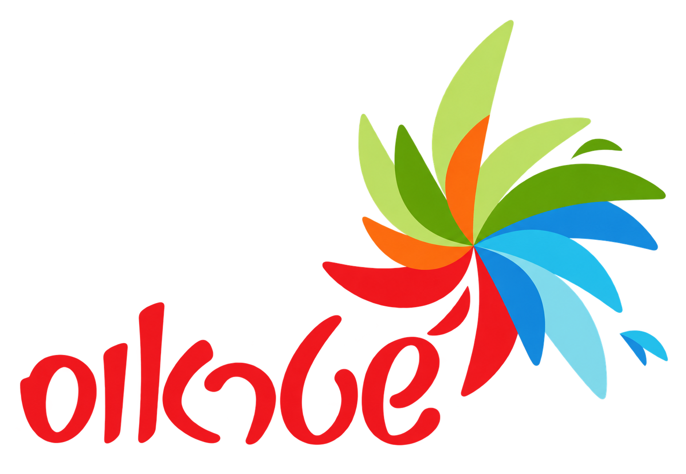
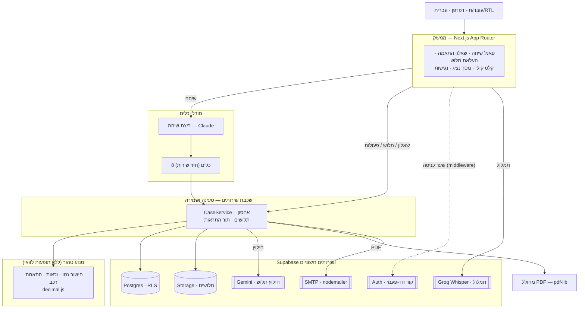

<div align="center">



# יועץ הרכב של שטראוס

**בוחרים רכב חברה בשיחה בעברית — ומבינים איך הבחירה משפיעה על הנטו ועל החיים.**

יועץ שיחתי שמחבר בין החישוב הכספי לבין ההחלטה האמיתית של העובד/ת:
כמה יישאר בסוף החודש, מה מותר לפי הזכאות, ומה מתאים למשפחה ולצרכים.

### ➜ [להתנסות במערכת החיה](https://strauss-car-advisor.vercel.app/)

<sub>סביבת הדגמה · עברית · RTL · נבנתה על Next.js</sub>


</div>

---

## הבעיה

החלטה על רכב חברה נשמעת פשוטה, אבל היא בעצם כמה החלטות שלובות זו בזו:

- **כסף.** רכב חברה אינו "הטבה חינם" — שווי השימוש נכנס לבסיס המס, ההשתתפות
  מקטינה את הנטו, ולרכב חשמלי יש גילום משלו. ההפרש בין שתי אפשרויות יכול להיות
  מאות שקלים בחודש, ולא תמיד לכיוון שמנחשים.
- **זכאות.** לא כל רכב פתוח לכל עובד/ת. הקבוצה, העיסוק, מספר הילדים והמסלול
  (רכב חברה / משפחתי / ויתור) קובעים מה בכלל אפשר לבחור.
- **חיים.** מספר מושבים, נפח מטען, גודל לחניה — הדברים שבאמת מכריעים ביום-יום.
- **מידע שחסר או דורש נציג.** חלק מהנתונים יושבים בתלוש, וחלק (כמו גובה ההשתתפות
  בפועל) ידועים רק לגורם בחברה.

הקושי אינו כל רכיב לבדו, אלא לחבר את כולם להחלטה אחת — בלי להסתבך בטבלאות מס
ובלי לנחש.

## הפתרון

יועץ הרכב מחבר את החלקים האלה לשיחה אחת בעברית. ההפרדה היא העיקרון המרכזי:
**המודל מבין את הבקשה ובוחר כלים; החישוב המספרי ואכיפת הכללים מתבצעים בקוד
דטרמיניסטי.** ההשוואה מחושבת בקוד לפי הנתונים שהעובד/ת מסר/ה, ההנחות המוצגות
וכללי האתגר — כך שהמספר ניתן להסבר ולשחזור, ואינו "השערה" של מודל שפה.

העובד/ת מדבר/ת בשפה חופשית ("יש לי Atto 3, מה אם אעבור ל-Dolphin?"), והמערכת
מחזירה את ההפרש בנטו עם פירוט ההנחות, ואפשרות להמשיך — להעלות תלוש, לברר מול
נציג, או לבדוק איזה רכב בכלל מתאים.

> ההשוואה משקפת את הנתונים שהוזנו ואת כללי האתגר. היא אינה מתיימרת לשחזר אחד-לאחד
> את תלוש השכר בפועל, אלא להראות באופן עקבי את ההפרש בין האפשרויות תחת אותן הנחות.

---

## מה אפשר לעשות במוצר

- **שיחה בעברית שמבינה כמה פרטים יחד.** אפשר למסור כמה נתונים במשפט אחד, לתקן
  ("השכר שלי בעצם 15,000"), להמשיך בירור קודם, ולבקש סימולציה ("מה אם השכר יעלה").
  המערכת מבדילה בין *תיקון עובדה* (משנה את המצב) לבין *סימולציה* (תרחיש היפותטי
  שלא נוגע בעובדות) — כך שלא מתבלבלים בין "מה יש לי" ל"מה אם".

- **השוואת נטו וזכאות דרך מנוע חישוב.** כל השוואה מריצה את מנוע הנטו הטהור מול
  תמונת קלט עקבית, כולל זכאות דטרמיניסטית לפי קבוצה/עיסוק/מסלול. המספרים הם פלט
  המנוע ומוצגים כפי שהם, לצד ההנחות ששימשו לחישוב.

- **השוואת כמה רכבים והצגת המובילים.** אפשר להשוות רשימת רכבים מפורשת, או לבקש
  סריקה של הקטלוג שממיינת לפי ההפרש בנטו ומציגה את האפשרויות המובילות. רכב שנפסל
  על זכאות מוצג עם הסיבה, לא נעלם בשקט.

- **העלאת תלוש, חילוץ נתונים ואישור לפני החלה.** מעלים PDF (כולל סרוק) או תמונה,
  המערכת מחלצת שכר בסיס, שיעורי פנסיה וקרן השתלמות ונקודות זיכוי — **ומציגה הכל
  לאישור או תיקון לפני שמחילים**. נתון שלא נמצא נשאר "לא ידוע", לא אפס. ההחלה
  אטומית: או שהכל נכנס, או כלום.

- **קלט קולי ותמלול.** אפשר להקליט ולדבר במקום להקליד. הדיבור מתומלל לעברית
  ונכנס לתיבת הטקסט **לעריכה ואישור** — לא נשלח אוטומטית, וההקלטה אינה נשמרת
  (עוברת בזיכרון בלבד). כשספק התמלול אינו מוגדר, כפתור המיקרופון פשוט אינו מוצג.

- **שאלון "איזה רכב מתאים לי?".** מתאים רכב לפי צרכים (נוסעים, מטען, גודל,
  עדיפות), על בסיס נתונים מאומתים בלבד וזכאות מחושבת. בלי מודל, בלי ציון התאמה
  מומצא — רכב שהנתון עליו חסר עובר ל"דורש בדיקה" עם הסבר, ולא מדורג כאילו הכל ידוע.

- **פנייה לנציג, מסך נציג והרשאות.** כשמשהו דורש גורם אנושי (למשל גובה ההשתתפות
  בפועל), אפשר לפתוח פנייה מתוך השיחה. יש מסך נציג נפרד שבו נציג מורשה רואה את
  הפניות שבהיקפו — **בלי שכר, נטו, מייל או זהות הבעלים** — ומשיב. ההרשאה נקבעת
  בשרת בלבד, deny-by-default.

- **התראה במייל וחזרה לאותו בירור.** אחרי שהנציג משיב, נשלחת התראה במייל (ללא
  סכומים) עם קישור שמחזיר בדיוק לאותו בירור — כולל התחברות ואימות בעלות בדרך.

- **שמירת בירורים והמשך שיחה.** כל בירור נשמר. אפשר לחזור, להמשיך את השיחה
  מהמקום שבו נעצרה, ולראות תשובות נציג שהגיעו בינתיים.

- **הורדת PDF.** מסמך השוואה דו-עמודי ב-A4, עברית RTL, עם ההפרש החודשי, שני
  כרטיסי מצב (היום / אחרי ההחלפה), פירוט מלא והנחות. המסמך מצייר רק את מספרי
  המנוע — אין בו חישוב משלו.

- **ממשק רספונסיבי, RTL, נגישות ואנימציות.** הממשק בעברית מלאה (כולל ה-PDF),
  כולל רכיב נגישות ייעודי (ניגודיות, גודל טקסט, עצירת תנועה) ואנימציות שנכבות
  תחת `prefers-reduced-motion`.

---

## תסריט שימוש מקצה לקצה

1. **כניסה.** משתמשים רגילים מתחברים בקוד חד-פעמי שמגיע למייל; מסך הכניסה כולל גם כניסת הדגמה בחשבון ייעודי ובקוד קבוע גלוי.
2. **שיחה.** "יש לי Atto 3 ואני מרוויחה 15,000 ברוטו. כמה אחסוך אם אעבור לדולפין?"
   המערכת מזהה את הרכבים, שואלת רק מה שחסר לחישוב, ומריצה את מנוע הנטו.
3. **תלוש (לא חובה).** אם חסר שכר בסיס או שיעורי הפרשה — מעלים תלוש, בודקים את
   מה שחולץ, מתקנים אם צריך, ומאשרים.
4. **השוואה.** מתקבל כרטיס השוואה עם ההפרש בנטו וההנחות; אפשר להוריד PDF.
5. **בירור לנציג.** אם ההשתתפות בפועל לא ידועה — "אפשר לברר מולם?" פותח פנייה.
6. **מייל וחזרה.** כשהנציג משיב, מגיע מייל עם קישור שמחזיר לאותו בירור, וההשוואה
   מתעדכנת עם הנתון שהתקבל.

> **מה מיועד להדגמה:** זו סביבת הדגמה. פניות הנציג לדוגמה הן פיקטיביות (עובדי
> הדוגמה של האתגר, ללא פרטים אישיים), ו"התנסות כנציג" מאפשרת לכל משתמש מחובר
> לחוות את מסך הנציג על הפניות שלו בלבד — זו אינה הרשאת נציג ארגונית. הרשאת נציג
> אמיתית ניתנת רק בערוץ ניהולי.

---

## הפיצ׳ר המקורי — "איזה רכב מתאים לי?"

רוב הכלים עונים על "כמה זה עולה". הפיצ'ר הזה עונה על השאלה שלפניה: *מה בכלל
מתאים לי?* — ומחבר את הבחירה הכספית לחיים של העובד/ת.

- **מנוע התאמה ללא מודל.** ההתאמה דטרמיניסטית לחלוטין (בלי רשת, מסד, מודל או
  זמן): סינון זכאות → דרישות הכרחיות (מספר מושבים) → זיהוי נתונים חסרים →
  דירוג לפי ההעדפה (נטו / מטען / גודל / איזון) על בסיס נתונים מאומתים ובני-השוואה
  בלבד → צירוף ההפרש בנטו מהמנוע הקיים.
- **נתוני רכב מאומתים בלבד.** הדירוג מסתמך רק על שדות שאושרו במקור הנתונים. נתון
  שחסר לעולם אינו מתפרש כאפס ואינו מוריד דירוג בשקט — הרכב עובר לרשימת "דורש
  בדיקה" עם הסבר מה חסר (למשל נפח מטען שנמדד בשיטה אחרת, או מידות שלא אושרו).
- **שקיפות של המשקולות.** באיזון, המשקולות מוצגות כבחירת מוצר ולא כמדד מדעי,
  ומנורמלות מחדש רק על הקריטריונים שיש להם נתונים בפועל.

---

## ארכיטקטורה



המימוש בפועל, לפי השכבות:

- **ממשק.** Next.js App Router, React, עברית/RTL מלאה. פאנל שיחה, שאלון התאמה,
  העלאת תלוש, קלט קולי, מסך נציג, רכיב נגישות.
- **מודל וכלים.** המודל **Claude** (`@ai-sdk/anthropic`) מנהל את השיחה ובוחר
  מתוך **שמונה כלים** המוגדרים כחוזי שירות: קריאת מצב, עדכון עובדות, עדכון הרכב
  הנוכחי, ניהול חלופות, חיפוש רכבים, השוואה, קריאת השוואה, פתיחת פנייה. ברירת
  המחדל היא מסלול השיחה המלא; קיים מסלול מהיר אופציונלי (`CHAT_FAST_PATH`) וגיבוי
  שיחה ל-Gemini לכשל ספק — **שניהם כבויים כברירת מחדל**.
- **שכבת שירותים.** כל טעינה ושמירה של נתונים עוברת דרך שכבת השירותים
  (`CaseService` ושירותי האחסון/ההתראות). המודל והכלים אינם ניגשים ישירות למסד —
  הם קוראים לשירותים, והשירותים אוכפים בעלות ומריצים את המנוע.
- **מנוע טהור.** מנוע הנטו (`decimal.js`, precision 40), מנוע הזכאות ומנוע
  ההתאמה — דטרמיניסטיים לחלוטין, ללא רשת, מסד, מודל או זמן. גילום החזר החשמל נפתר
  בפתרון מספרי (bisection) ולא בנוסחה מקורבת. המנוע אינו ניגש למסד; שכבת השירותים
  מזינה לו קלט ושומרת את הפלט.
- **Supabase ושירותים חיצוניים.** **Postgres** עם RLS מפורש (`WITH CHECK`) על
  כל טבלאות הבעלים ותפקידי DB בהרשאות מינימום; **Supabase Storage** (bucket פרטי)
  לתלושים; **Supabase Auth** לקוד החד-פעמי; **Gemini** (`@ai-sdk/google`) לחילוץ
  תלוש; **Groq Whisper** (`whisper-large-v3-turbo`) לתמלול; **nodemailer** (SMTP)
  להתראות האפליקציה. מחולל ה-PDF (**pdf-lib**) מופעל דרך שכבת השירותים ומצייר את
  מספרי המנוע.

---

## אמינות ופרטיות

- **אישור נתוני תלוש.** הנתונים שחולצו מתלוש אינם מוחלים אוטומטית — הם מוצגים
  לאישור ועריכה. ההחלה אטומית: סימון "הוחל" ועדכון העובדות קורים בטרנזקציה אחת,
  וקונפליקט מגלגל את שניהם אחורה. אין החלה כפולה.
- **חוסר מידע מטופל כחוסר.** נתון שלא נמצא נשאר "לא ידוע" ולא הופך לאפס. אפס
  נרשם רק כשהוא מופיע במפורש. המנוע דוחה קלט לא תקין במקום להחזיר "נטו" שגוי בשקט.
- **בידוד משתמשים.** כל גישה לנתוני בעלים רצה בטרנזקציה שמגדירה `app.owner_id`
  מהשרת בלבד (לעולם לא מהלקוח), ופוליסות RLS מסננות כל שאילתה לפיו. תיק, הודעות,
  עובדות ומסמכים של משתמש אחד אינם נקראים או נכתבים על ידי אחר.
- **הרשאות לפי תפקיד.** עובד/ת רואה רק את התיקים והבירורים של עצמו/ה. נציג מורשה
  רואה הקשר מצומצם בלבד של פניות שבהיקפו (ללא שכר, נטו, מייל או זהות הבעלים), ובעל
  התיק נגזר בשרת ולא מהלקוח. התנסות הנציג להדגמה מוגבלת לפניות הבדיקה של המשתמש
  עצמו ואינה הרשאה ארגונית.
- **קלט קולי ומסמכים.** ההקלטה הקולית אינה נשמרת — היא עוברת בזיכרון לספק התמלול
  ונזרקת; רק הטקסט חוזר. תלושים נשמרים ב-Storage פרטי בנתיב אטום, והגישה אליהם
  נאכפת לפי בעלות (RLS) לפני כל קריאה/כתיבה/מחיקה. תוכן מסמך מטופל כ**נתונים בלבד**
  — הוראות שמופיעות בתוכו אינן מבוצעות.
- **התאוששות מכשלים.** התראות נשמרות כמשימות עמידות עם ניסיונות חוזרים; כשל מייל
  אינו מבטל תשובה או חישוב שכבר נשמרו. חילוץ שממתין לאישור משוחזר אחרי רענון.
- **גבולות סביבת ההדגמה.** חלק מהתכונות תלויות בהגדרת ספק/מכסה (חילוץ תלוש,
  תמלול, מייל), ובמיצוי מכסה מוחזרת הודעה ברורה עם חלופה ידנית. אין כאן ייעוץ מס
  או משפטי — המספרים מבוססים על קובץ הכללים הנתון.

> הערה: אין טענה לעמידה מלאה בתקן נגישות או ל"אבטחה מוחלטת". אימות נגישות מלא
> דורש בדיקה ידנית עם טכנולוגיות מסייעות וסקירת מומחה.

---

## בדיקות

הבדיקות מבחינות במכוון בין מה שנבדק אוטומטית, מה שנבדק מול מודל אמיתי, ומה
שעדיין דורש בדיקה ידנית בדפדפן ובפרודקשן.

| שכבה | מה נבדק | סטטוס |
|---|---|---|
| יחידה + property-based (ללא מודל) | מנוע נטו (התאמה לשקל לעובדי הייחוס, גילום חשמל, שווי שימוש בבסיס המס, אי-שליליות/מונוטוניות), זכאות, התאמת רכב, יבוא CSV/קטלוג | ✅ נבדק אוטומטית |
| שירותים + אינטגרציה מול Postgres (RLS) | יצירה/חלופה/חישוב/שחזור, בידוד בעלים, זרימת תלוש בצד שרת (אישור אטומי, חוסר≠אפס, אי-החלה כפולה), מסך נציג, אחסון, התחברות, שער כניסה | ✅ נבדק אוטומטית |
| הבנת שיחה (מודל אמיתי) | בחירת כלים, תיקון מול סימולציה, זיהוי רכב, המשכיות אחרי רענון | ◐ נבדק בהרצות מאושרות; נמצאו וטופלו חידודי פרומפט, התנהגות מעודכנת ממתינה להרצה נוספת |
| דפדפן (מקצה-לקצה) | חילוץ תלוש אמיתי עם Gemini, זרימת התלוש המלאה, מסך הנציג בדפדפן | ◐ מתועד ומבוצע ידנית (ראו docs) |
| פרודקשן (Vercel) | שער הכניסה ב-HTTP נקי, קבלת קוד כניסה במייל | ◐ אומת חלקית; תהליכים תלויי-ספק נבדקים ידנית |

הרצת `npm test` מציגה את הספירה והסטטוס העדכניים בסביבה שלך (כולל בדיקות
האינטגרציה כש-env המסד מוגדר). פירוט ממצאים ותיקונים:
[docs/audit-report.md](docs/audit-report.md) ו-[docs/payslip-browser-test.md](docs/payslip-browser-test.md).

> סבב הבדיקות מול מודל אמיתי אינו "מושלם וסגור": אותרו כשלי סגנון/זרימה בשיחה,
> תוקנו בפרומפט ובקוד הבדיקות, וההתנהגות המעודכנת ממתינה לאימות בהרצת מודל נוספת.
> אין צורך בהרצה מחדש לצורך עריכת תיעוד זו.

---

## הרצה מקומית

**דרישות:** Node.js 20+.

```bash
npm install          # התקנת תלויות
npm run dev          # מסך העובד/ת ב-http://localhost:3000

npm test             # Vitest (יחידה + אינטגרציה מול Postgres כש-env מוגדר)
npm run typecheck    # tsc --noEmit
npm run build        # בניית פרודקשן של Next.js

npm run db:migrate                 # החלת מיגרציות SQL (דורש MIGRATION_DATABASE_URL)
npm run import:dataset             # יבוא ה-dataset למסד (דורש חיבור)
npm run db:set-notifier-password   # יצירת תפקיד ה-worker ובניית NOTIFY_DATABASE_URL
```

> אל תריצו `build` בזמן ש-`dev` פעיל, ואל תמחקו את `.next` תחת `dev` רץ (עלול
> לגרום ל-Internal Server Error / webpack cache פגום). אם קרה — עצרו `dev`,
> מחקו `.next`, הפעילו `dev` מחדש.

**משתני סביבה.** העתיקו את `.env.example` ל-`.env.local` ומלאו ערכים (סודות
נטענים בצד שרת בלבד, ללא `NEXT_PUBLIC`; לא בצ'אט ולא ב-git). הטבלה מציגה שמות
והסברים בלבד:

| משתנה | לְמה | נדרש |
|---|---|---|
| `DATABASE_URL` | תפקיד האפליקציה (`strauss_app`) הכפוף ל-RLS | לריצה מול מסד |
| `MIGRATION_DATABASE_URL` | תפקיד הבעלים, להרצת מיגרציות בלבד | למיגרציות |
| `SUPABASE_URL` · `SUPABASE_ANON_KEY` | התחברות (OTP למשתמשים רגילים וכניסה לחשבון הדגמה) | להתחברות |
| `DEMO_LOGIN_CODE` | סיסמת חשבון הדמו (צד שרת בלבד) | לכניסת הדגמה |
| `SUPABASE_SERVICE_ROLE_KEY` | אחסון תלושים ב-Supabase Storage (צד שרת) | לתלושים בפרודקשן |
| `MODEL_API_KEY` | מפתח Claude (שיחה) | לשיחה |
| `MODEL_API_KEY3` | מפתח Gemini (חילוץ תלוש; גיבוי: `MODEL_API_KEY2`) | לחילוץ תלוש |
| `TRANSCRIBE_API_KEY` | מפתח Groq (תמלול). ריק = כפתור המיקרופון אינו מוצג | לקלט קולי |
| `SMTP_USER` · `SMTP_PASS` · `MAIL_FROM` | שליחת התראות מייל מהאפליקציה | להתראות |
| `APP_BASE_URL` | כתובת הבסיס לקישור החזרה בתוך המייל | להתראות |
| `NOTIFY_DATABASE_URL` | חיבור ה-worker המצומצם (`strauss_notifier`, `notification_jobs` בלבד) | לעיבוד התראות |
| `CRON_SECRET` | הגנת ה-cron שמריץ את עיבוד ההתראות | לעיבוד התראות |

> מפתח השיחה (`MODEL_API_KEY`, Claude) ומפתח החילוץ (`MODEL_API_KEY3`, Gemini)
> הם מפתחות וספקים נפרדים, כך שחיוב/מכסה של חילוץ התלוש אינם מתערבבים עם השיחה.

מדריכי הגדרה מלאים:

- [docs/supabase-setup.md](docs/supabase-setup.md) — מסד, תפקידים, מיגרציות.
- [docs/auth-setup.md](docs/auth-setup.md) — התחברות והרשאות.
- [docs/notifications-setup.md](docs/notifications-setup.md) — התראות מייל ו-worker.
- [docs/representative-access.md](docs/representative-access.md) — אזור נציג והדגמה.
- [docs/vercel-deploy.md](docs/vercel-deploy.md) — פריסה ל-Vercel.
- [docs/payslip-browser-test.md](docs/payslip-browser-test.md) — בדיקת תלוש בדפדפן.
- [docs/decision-log.md](docs/decision-log.md) — יומן החלטות.

---

## על הפיתוח

הפרויקט פותח על ידי **חדוה אברמוביץ** במסגרת אתגר שטראוס של קהילת קוד פתוח.

לאורך הפיתוח נעזרתי ב-**Kiro** ו-**ChatGPT** ככלי עזר — לתכנון וארכיטקטורה, מחקר
(כללי מס ושווי שימוש, ספריות, שיטות), כתיבת קוד ותיעוד, ובניית הבדיקות. המודל
משמש במוצר להבנת הבקשה ולבחירת הכלים; **החישוב המספרי ואכיפת הכללים מתבצעים בקוד
דטרמיניסטי ונבדקו**, כך שהתוצאה ניתנת להסבר ולשחזור.
